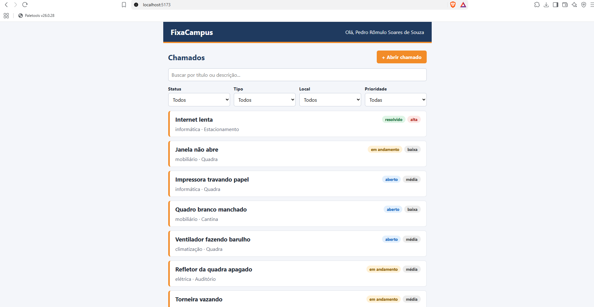
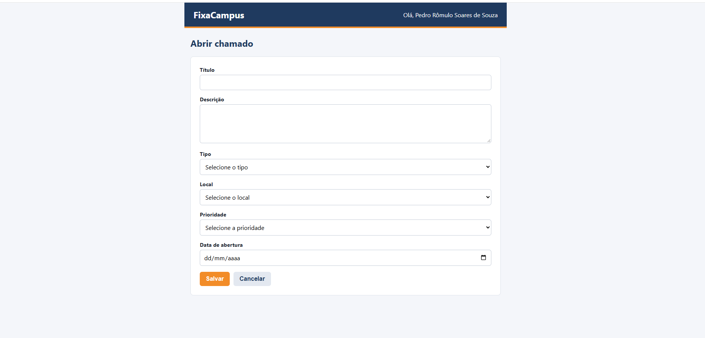
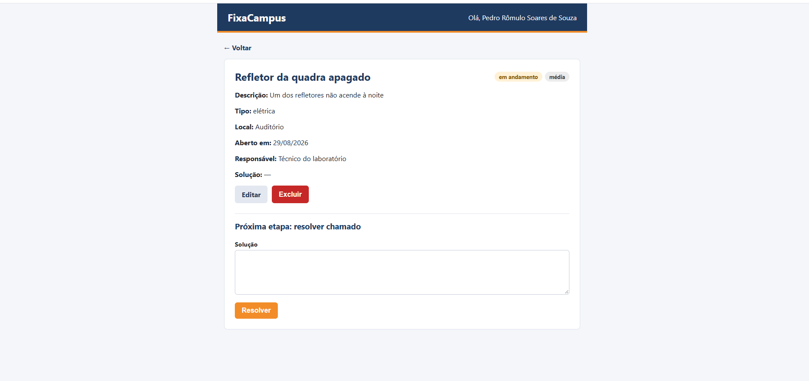

# FixaCampus — Chamados de Manutenção

Front-end do sistema de chamados de manutenção do IFRN Campus Pau dos Ferros, feito em React + Vite, React Router e Axios, consumindo a API https://api-chamados.jefersonqueiroga.com.br.

Projeto da disciplina de Programação para Internet.

## Como rodar

1. Instale as dependências: `npm install`
2. Crie o arquivo `.env` na raiz com a sua chave:
   ```
   VITE_API_KEY=sua-chave-aqui
   ```
3. Rode o projeto: `npm run dev`
4. Abra o endereço mostrado no terminal (geralmente http://localhost:5173).

## Screenshot




